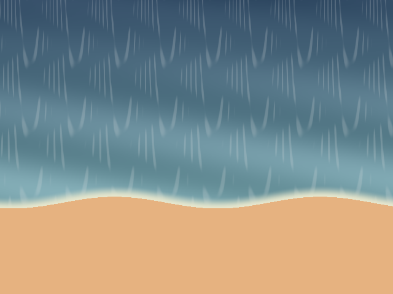

# beach :D

This shader shows a beach with the sand moving up and down and like some foam and the white stuff is the white shiny stuff that happens on water at the beach \(idk what it's called, but I think it has to do with like reflections and sunlight \(??\) my bad\)

Play it: https://shadergator.hackclub.com/ships/49

## Files

| File | Contents |
| --- | --- |
| `image.glsl` | The code of the Image tab. |
| `shader.json` | The whole shader in Shadertoy's export format. |
| `screenshot.png` | The screenshot. |

## Paste it into Shadertoy

1. Open https://www.shadertoy.com/new and sign in.
2. Select all the code in the Image tab, and paste the contents of `image.glsl` over it.
3. Press the play button below the code, or Alt+Enter, to compile it.

## Licence

MIT. See `LICENSE`.
